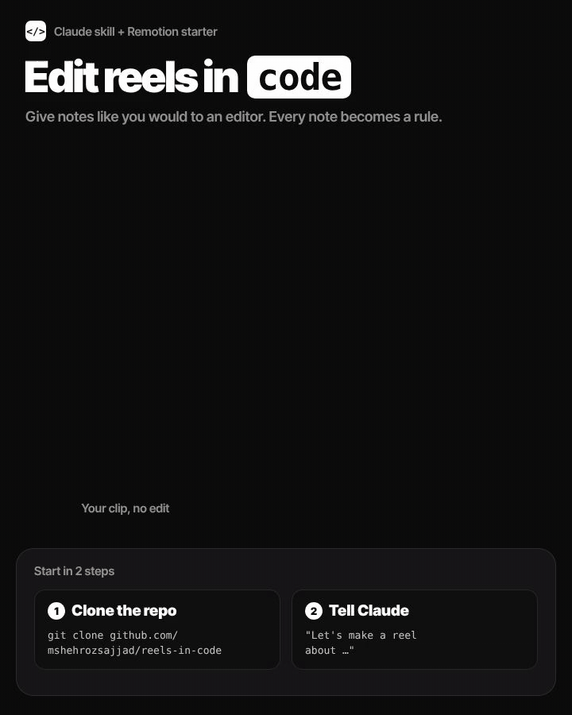

# Reels in Code

**A Claude skill that makes a whole reel from your idea.** Tell it what the video is about. It writes 3 hooks, writes the script, plans every shot, and asks only for the clips it needs. You send them, and it edits and renders the reel — as code, with no editing app.

Works with **any footage** (phone, camera, screen recordings, AI avatar) and **any voice** (your own, or any text-to-speech). Runs in the Claude app and in Claude Code.

## How it goes

1. **Intake** — your idea, what you actually did or know (it never invents facts), length, and the look: the built-in Style C, or a reference video you like.
2. **3 hooks** — three different angles. You pick one.
3. **Script** — written for feeds: payoff first, one late peak, a loop ending.
4. **Shot list** — every line, what's on screen, and the exact clips to film.
5. **Clips** — you send them; it checks each one and tells you right away if one needs a reshoot.
6. **Edit** — word-timed captions, cut-ins, screen recordings, the big word behind you.
7. **Preview + notes** — give notes like you would to an editor. Lasting ones are saved to your `RULES.md`.
8. **Render** — a sharp 1440×2560 file, plus caption, hashtags and alt text.

## Install

Download this repo (Code → Download ZIP) and take the **`reels-in-code`** folder — that folder is the skill.

- **Claude app:** zip the `reels-in-code` folder and upload it in your Skills settings. Make sure code execution is on.
- **Claude Code:** copy the folder to `~/.claude/skills/reels-in-code`.

Then start a chat: *"Let's make a reel about …"*

The skill sets up its own project (Node + Python packages) the first time. Rendering locally needs [Node.js](https://nodejs.org) 18+, Python 3.10+ and [ffmpeg](https://ffmpeg.org); the Claude app's sandbox usually has them.

## Style C

The default look: one typeface (Inter Tight), a big keyword with small words above and below, each word fading in as it's spoken, a black gradient low in the frame, and one giant word behind the speaker on the peak line. Want something else? Show it a reel you like and it saves that as your own style.

## What's inside

| | |
|---|---|
| `reels-in-code/SKILL.md` | The flow Claude follows, idea to render |
| `reels-in-code/reference/` | How to write for feeds; the edit file format |
| `reels-in-code/styles/style-c.md` | The default look |
| `reels-in-code/template/` | The Remotion project copied for each reel. The whole edit lives in `public/edit.json` |
| `reels-in-code/tools/` | `timings.py` (times every word), `build_edit.py` (script → edit file), `matte.py` (cuts you out for the word-behind-you effect) |

## License

MIT. Use it, change it, make it yours. Inter Tight is under the SIL Open Font License.
